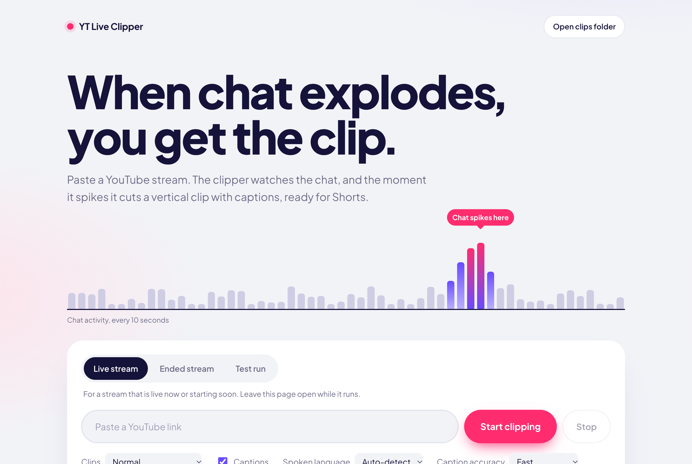
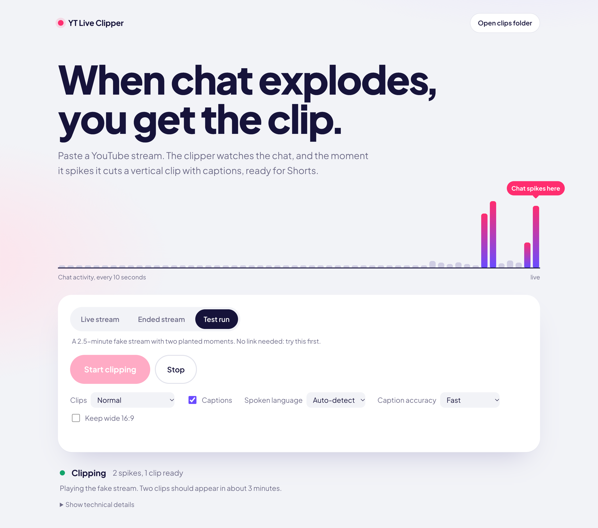
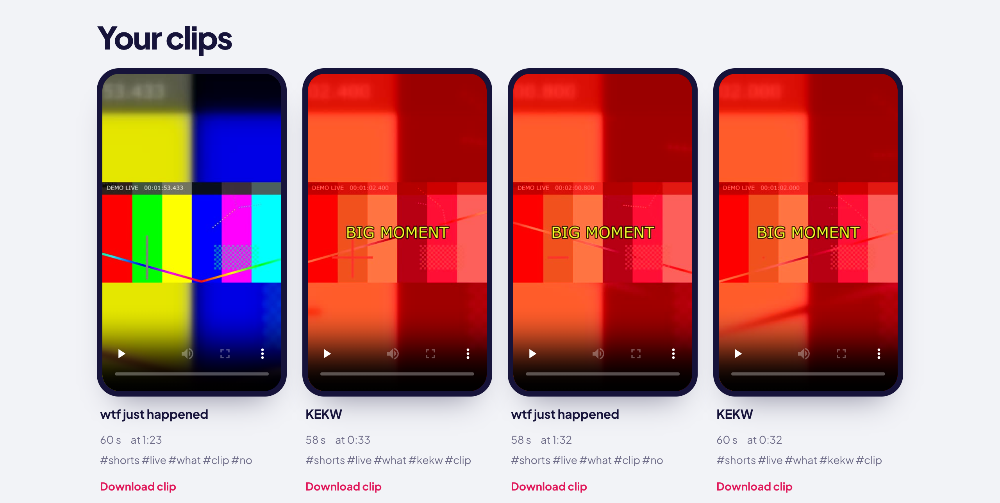
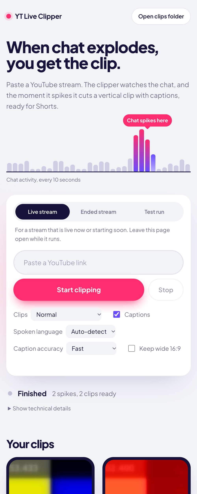

# YT Live Clipper

Free, local auto-clipper for **YouTube live streams**. It watches the live
chat, detects the moments where chat explodes ("NO WAY 💀", "CLIP IT",
super chats...), and while the stream is **still live** cuts a ready-to-post
**vertical 9:16 clip with word-by-word captions** for every moment.

No API keys, no accounts, no subscriptions. Everything runs on your computer.



```
stream ──► streamlink ──► ffmpeg (rolling buffer, 4s segments, no re-encode)
                                         │
chat ────► yt-dlp live chat ──► spike detector ──► clip window ──► ffmpeg cut
           (fallback: chat-downloader)                               │
                                              faster-whisper captions ┘──► 9:16 clip.mp4
                                                                          + captions.srt
                                                                          + meta.json
                                                                          + index.html gallery
```

## Free open-source building blocks

| Job | Tool | Why |
|---|---|---|
| Record the live stream | [streamlink](https://github.com/streamlink/streamlink) (fallback: yt-dlp) | Built for live HLS, handles reconnects |
| Read live chat | [yt-dlp](https://github.com/yt-dlp/yt-dlp) live_chat (fallback: [chat-downloader](https://github.com/xenova/chat-downloader)) | Most maintained YouTube tool; no API key |
| Cut / render | [FFmpeg](https://github.com/FFmpeg/FFmpeg) + libass | Industry standard |
| Captions | [faster-whisper](https://github.com/SYSTRAN/faster-whisper) | Whisper, runs locally on CPU, free |

All are free and open source (MIT/BSD/LGPL/Unlicense). The Whisper model is
downloaded once (free, from Hugging Face) the first time captions run.

## Download

Click the green **Code** button above → **Download ZIP**, then unzip it. Or, with git:
```bash
git clone https://github.com/jatinsinghal9716/yt-live-clipper.git
cd yt-live-clipper
```
Then use the one-click installer: double-click **`install_windows.bat`** on Windows, or run
`bash install_mac_linux.sh` on Mac/Linux. The manual steps are below.

## Easiest way to use it: the web page

After installing, double-click **`START_CLIPPING.bat`** (Windows) or **`START_CLIPPING.command`**
(Mac; the first time, right-click it → **Open**). On Linux run `ytclip web`.

A page opens in your browser at `http://127.0.0.1:8765`. It runs only on your own computer.
1. Pick **Live stream**, **Ended stream** or **Test run** (try Test run first).
2. Paste the YouTube link and press **Start clipping**.
3. Clips appear on the page as they're made. Play them there, download them, or press
   **Open clips folder**. **Stop** finishes the clip in progress and keeps everything made so far.

Keep the black window open while clipping; closing it quits. Prefer typing commands? Everything below works too.

**While it runs**, the chat meter fills in with real chat activity and the bars turn pink where chat spiked.
Each spike becomes a clip:



**Your clips** appear on the same page, ready to play or download:



It works on small screens too:



*Screenshots use the built-in Test run (a fake stream), so no real streamer's video is shown.*

## Install (one time)

You need **Python 3.9-3.13** (faster-whisper has no wheels for newer Pythons yet) and **FFmpeg with libass**.

**Windows** (PowerShell):
```powershell
winget install Python.Python.3.12
winget install Gyan.FFmpeg
# close and reopen PowerShell, then in this folder:
python -m venv .venv
.venv\Scripts\activate
pip install -e .
ytclip doctor
```

**macOS** (easiest: `bash install_mac_linux.sh`). Homebrew's normal `ffmpeg` has no libass,
so captions can't be burned in; use the full build from the homebrew-ffmpeg tap:
```bash
brew install python@3.12
brew uninstall ffmpeg 2>/dev/null; brew tap homebrew-ffmpeg/ffmpeg && brew install homebrew-ffmpeg/ffmpeg/ffmpeg
python3.12 -m venv .venv && source .venv/bin/activate
pip install -e .
ytclip doctor
```

**Linux (Ubuntu/Debian)**:
```bash
sudo apt install python3-venv ffmpeg
python3 -m venv .venv && source .venv/bin/activate
pip install -e .
ytclip doctor
```

`ytclip doctor` should say **all good!**

### Try it without YouTube first (3 minutes)
```bash
ytclip demo
```
This plays a fake stream with fake chat (two "BIG MOMENT"s) through the full
pipeline. It's the same code that runs on a real stream. Open
`clips_output/session-*/clips/index.html` to see the results.

## Use it on a live stream

```bash
ytclip live "https://www.youtube.com/watch?v=VIDEO_ID"
# or a channel's current live stream:
ytclip live "https://www.youtube.com/@ChannelName/live"
# scheduled stream that hasn't started yet: start now, it waits
ytclip live "https://www.youtube.com/@ChannelName/live" --wait
```

Leave it running. You'll see a status line every 10 s, `SPIKE!` when chat
pops off, then `CLIP READY` about a minute later. Press **Ctrl+C** to stop.
Pending clips still finish.

Output for every clip (`clips_output/session-<time>/clips/001_HHMMSS/`):
- `clip.mp4`: 1080x1920 vertical clip with burned-in captions, ready for Shorts/TikTok/Reels
- `raw.mp4`: the original 16:9 cut
- `captions.srt`: captions to upload separately
- `thumb.jpg`, `meta.json`: suggested title, hashtags, transcript, top chat messages, spike strength

`clips/index.html` is a gallery of every clip; refresh it while the stream runs.

### Useful options
| Option | What it does |
|---|---|
| `--sensitivity high` | more clips (small streams with slow chat) |
| `--sensitivity low` | fewer, only huge moments (big streams) |
| `--pre 30 --post 8` | seconds kept before / after the chat spike |
| `--max-length 60` | clip length cap (60 = Shorts) |
| `--horizontal` | keep 16:9 instead of vertical |
| `--no-captions` | skip Whisper (much faster on slow PCs) |
| `--whisper-model small` | better captions (`tiny` < `base` < `small` < `medium` < `large-v3`) |
| `--device cuda` | use an NVIDIA GPU for captions |
| `--language hi` | caption language (`hi`, `te`, `ta`, `es`...). Set it for Indian languages: auto-detect often guesses wrong on short, noisy clips |
| `--whisper-model large-v3-turbo` | most accurate captions, best for Hindi and other non-English speech (about 35 s per clip, 1.6 GB one-time download) |
| `--quality 720` | record lower quality (less CPU/disk) |
| `--buffer-minutes 15` | how much stream is kept on disk (old parts auto-deleted) |
| `--keep-recording` | also keep the full stream recording |
| `--chat-delay 5` | clips start too late? shift chat 5 s earlier |
| `--recorder yt-dlp` | use yt-dlp instead of streamlink to record |
| `--chat chat-downloader` | force the other chat reader |
| `--max-clips 20` / `--duration 3600` | stop automatically |
| `--cookies cookies.txt` | only for members-only / age-restricted streams |

## Streams that already ended (bonus)

The video's "catch" was that you can't rewind a stream that already ended.
If the stream kept its **chat replay**, you can:

```bash
ytclip replay "https://www.youtube.com/watch?v=VIDEO_ID" --top 10
ytclip replay "https://www.youtube.com/watch?v=VIDEO_ID" --dry-run   # just list moments
```

It downloads only the chat (small), finds the top moments, and then downloads
only those few seconds of video. It never downloads the full 8-hour VOD.

## How the spike detection works

- Chat is counted in 10-second windows. Each message is worth 1 point, with bonuses
  for hype words and emotes (`no way`, `KEKW`, `💀`, `W`...), ALL CAPS, `!!`, "clip it",
  and super chats.
- **Anti-spam:** one person can add at most 3 points per window, so a single spammer can't fake a moment.
- A window is a spike when it beats the stream's own rolling 6-minute baseline
  (≥ 2x the median **and** median + 3 robust std-devs **and** at least 3 different people).
  Small and huge streams both work because each is compared with its own normal.
- **Any language:** spikes come from how many people are typing, so Hindi, Hinglish, Tamil,
  Spanish, Korean... chats all work. Hype words and laughter (`भाई`, `kya baat`, `jajaja`, `ㅋㅋㅋ`, `草`,
  `wkwk`) in many languages add a small bonus.
- **Emojis:** every emoji counts as a reaction (including skin tones, flags, combined ones like 🤦‍♂️
  and YouTube's own channel emojis). Hype emojis like 😂💀🔥 and repeats like 😂😂😂 count more.
- Neighbouring spike windows merge into one moment. Chat reacts **after** the event,
  so the clip keeps 30 s before the spike and 8 s after it.

## Tips
- Run it on a PC that stays on. A stream in 1080p uses about 1-3 GB per hour of
  buffer, which is automatically deleted.
- Caption speed on CPU with `base` is about 5-15 s per clip. Use `tiny` on
  old laptops, or `small` / `--device cuda` for better accuracy.
- Only post clips you have the right to post (your own streams, streamers who allow
  clipping, or with permission). Respect YouTube's Terms of Service.

## Tests
```bash
pip install pytest
pytest -q
```

## Troubleshooting
- **`recorder produced no video`**: the stream isn't live (use `--wait`), or it's
  members-only (use `--cookies`). Try `--recorder yt-dlp`.
- **`chat stopped`**: the stream has chat disabled. (`--chat chat-downloader` is a last
  resort only: as of Nov 2026 it can't parse YouTube's pages any more.)
- **YouTube changed something**: update the tools with `pip install -U yt-dlp streamlink`.
- **No clips on a quiet stream**: use `--sensitivity high` or `--min-score 3`.
